# Mantenimiento IPF

App para que alumnos y docentes del **Instituto Politécnico Formosa** reporten desperfectos del edificio (una luz quemada, una canilla que pierde, un proyector roto) y reciban un aviso cuando se resuelven.

Trabajo Práctico N° 3 "Permisos móviles", Taller Complementario React Native II. Hecha con **Expo SDK 57**, **Expo Router** y **TypeScript**.

La app usa la **cámara** (leer el QR del aula y sacar fotos), la **ubicación en primer plano** y las **notificaciones locales**. Para elegir una foto de la galería usa el selector del sistema, **sin permiso de galería**. Ningún permiso se pide al abrir la app: cada uno se pide al tocar su función, después de una pantalla previa. Si se deniega, siempre hay una alternativa y el reporte se puede guardar igual.

---

## Cómo correrla

```bash
npm install
```

| Para… | Comando |
|---|---|
| Probar en **Expo Go** (lógica, estados, alternativas, bandeja de avisos; en Android las notificaciones figuran "no disponible") | `npm run start:go` |
| Abrir en la **development build** (textos de propósito, permisos reales y notificaciones) | `npm start` |
| Compilar la development build de Android en la nube (EAS) | `eas build --profile development --platform android` |
| Compilar un APK de prueba sin dev client | `eas build --profile preview --platform android` |
| Ver los archivos nativos que se generan | `npm run prebuild` (regenera `android/`; no se sube a git) |
| Chequeos | `npm run typecheck`, `npm run lint`, `npm run doctor`, `npm test` |

- **Sin túnel:** la red del instituto bloquea ngrok, así que el celular y la PC tienen que estar en la misma red. Si la Wi-Fi aísla los dispositivos, usar el hotspot del celular o USB con `adb reverse tcp:8081 tcp:8081`.
- **Development build:** cómo compilarla desde Windows está en [docs/PRUEBAS.md](docs/PRUEBAS.md#6-development-build-en-android-desde-windows).

---

## Rutas (`src/app`)

```
src/app/
├── _layout.tsx              # Stack raíz + Provider del almacén + setNotificationHandler y listeners
├── +not-found.tsx
├── (tabs)/
│   ├── _layout.tsx          # Tabs: Reportes · Avisos · Permisos
│   ├── index.tsx            # /            → lista de reportes
│   ├── avisos.tsx           # /avisos      → bandeja de avisos (alternativa a las notificaciones)
│   └── permisos.tsx         # /permisos    → panel de permisos
├── permisos/
│   └── [recurso].tsx        # /permisos/camara|ubicacion|notificaciones  (presentation: "modal")
├── reporte/
│   ├── nuevo.tsx            # /reporte/nuevo
│   ├── escanear.tsx         # /reporte/escanear
│   ├── foto.tsx             # /reporte/foto
│   ├── ubicacion.tsx        # /reporte/ubicacion
│   └── [id].tsx             # /reporte/:id
└── ajustes-app.tsx          # /ajustes-app
```

`/reporte/nuevo` no cae en `[id]` porque Expo Router prioriza las rutas estáticas. Además, `[id]` valida el formato con `esIdValido()`.

**Resto del código**

| Carpeta | Qué hay |
|---|---|
| `src/components` | `PantallaPrevia`, `AvisoBloqueado`, `Cargando`, `FilaPermiso`, `TarjetaReporte`, `EtiquetaEstado`, selectores |
| `src/hooks` | `usePermiso` (hook unificado) y `useRevisarAlVolver` (AppState) |
| `src/lib` | `permisos.ts` (adaptador por recurso), `interpretar.ts` (respuesta → 4 estados, sin código nativo), `almacen.tsx` (reportes y avisos en AsyncStorage), `navegacion.ts`, `qr.ts`, `ids.ts` |
| `scripts` | Pruebas de `interpretar()` y del lector de QR (`npm test`) |
| `docs` | Consigna, presentación, [auditoría del manifiesto](docs/AUDITORIA_MANIFIESTO.md), [pruebas](docs/PRUEBAS.md) y [guía para la defensa](docs/DEFENSA.md) |

---

## Permisos

| Recurso | Módulo | Cuándo se pide | Alternativa si se deniega |
|---|---|---|---|
| Cámara (QR del aula) | `expo-camera` (`useCameraPermissions`) | Al tocar "Escanear QR del aula" en `/reporte/nuevo` → pantalla previa → "Continuar" | Escribir el código del aula a mano |
| Cámara (foto) | `expo-camera` (`CameraView` + `takePictureAsync`) | Al tocar "Sacar foto" en `/reporte/foto` → pantalla previa → "Continuar" | Elegir la foto de la galería (sin permiso) |
| Fotos de la galería | `expo-image-picker` (`launchImageLibraryAsync`) | **Nunca**: es el selector del sistema | No hace falta |
| Ubicación (primer plano) | `expo-location` | Al tocar "Marcar ubicación" → `/reporte/ubicacion` (con los sectores siempre visibles) → "Usar mi ubicación" → pantalla previa → "Continuar" | Elegir el sector a mano (patio, estacionamiento, pasillo, aula, otro) |
| Notificaciones | `expo-notifications` | Al activar "Avisarme cuando se resuelva mi reporte" en `/ajustes-app` → pantalla previa → "Continuar" (en Android crea antes el canal `reportes`) | Bandeja `/avisos` dentro de la app |

Si un permiso está **bloqueado** (`canAskAgain: false`), la app no vuelve a pedirlo: muestra el camino exacto en Ajustes para Android o iOS y el botón "Abrir Ajustes". Al volver de Ajustes, la app vuelve a consultar el estado (`AppState`).

### Bloque `plugins` de `app.json`, comentado

```jsonc
"plugins": [
  "expo-router",
  ["expo-splash-screen", { /* pantalla de carga de la plantilla */ }],

  ["expo-camera", {
    // Texto de NSCameraUsageDescription (iOS). Molde: "Usamos tu [dato] para [beneficio]".
    "cameraPermission": "Usamos tu cámara para leer el QR de la puerta del aula y sacar fotos del desperfecto que reportás.",
    // No grabamos video con sonido: sin NSMicrophoneUsageDescription en iOS…
    "microphonePermission": false,
    // …y sin RECORD_AUDIO en Android (expo-camera lo agrega por defecto para grabar video).
    "recordAudioAndroid": false
  }],

  ["expo-location", {
    // Texto de NSLocationWhenInUseUsageDescription: solo "mientras se usa la app".
    "locationWhenInUsePermission": "Usamos tu ubicación para marcar en qué parte del edificio está el problema que reportás.",
    // Sin estas tres en false, el plugin agrega textos genéricos para "Siempre" y
    // para el sensor de movimiento, aunque la app no los use.
    "locationAlwaysAndWhenInUsePermission": false,
    "locationAlwaysPermission": false,
    "motionUsagePermission": false,
    // Nada de segundo plano: ni UIBackgroundModes en iOS ni ACCESS_BACKGROUND_LOCATION en Android.
    "isIosBackgroundLocationEnabled": false,
    "isAndroidBackgroundLocationEnabled": false
  }],

  ["expo-image-picker", {
    // Usamos el selector del sistema: no hace falta NSPhotoLibraryUsageDescription.
    "photosPermission": false,
    // Sin micrófono: además, el plugin bloquea RECORD_AUDIO en Android.
    "microphonePermission": false
    // A propósito NO lleva "cameraPermission": con false, el plugin bloquearía CAMERA en
    // Android y dejaría sin cámara a expo-camera. Ver docs/AUDITORIA_MANIFIESTO.md.
  }],

  ["expo-notifications", {
    // Color del ícono de la notificación en Android (el mismo azul de la app).
    "color": "#1E5AA8"
  }]
]
```

### Por qué cada permiso de `blockedPermissions`

`android.blockedPermissions` agrega `tools:node="remove"` al manifiesto. Así el permiso no entra al APK aunque lo declare alguna librería o la plantilla.

| Permiso bloqueado | Quién lo agregaría | Por qué lo sacamos |
|---|---|---|
| `RECORD_AUDIO` | `expo-camera`, `expo-image-picker` | No grabamos audio ni video con sonido |
| `ACCESS_BACKGROUND_LOCATION` | `expo-location` (si se activa segundo plano) | Solo usamos la ubicación con la app abierta; Google Play exige justificar el segundo plano |
| `READ_MEDIA_IMAGES` | — (por si una librería lo suma) | Las fotos se eligen con el selector del sistema, que no necesita permiso. Google Play lo restringe a apps que necesitan toda la galería |
| `READ_MEDIA_VIDEO` | — | No usamos videos |
| `READ_MEDIA_VISUAL_USER_SELECTED` | — | Es el "acceso parcial" de Android 14: tampoco lo necesitamos con el selector |
| `READ_EXTERNAL_STORAGE` | plantilla, `expo-image-picker`, `expo-file-system` (hasta Android 12) | Mismo motivo: el selector no lo necesita |
| `WRITE_EXTERNAL_STORAGE` | plantilla, `expo-image-picker`, `expo-file-system` (hasta Android 12) | Las fotos que saca la app quedan en su caché, que no requiere permiso |
| `SYSTEM_ALERT_WINDOW` | plantilla de prebuild | Permiso especial para dibujar sobre otras apps: no lo usamos |

### Auditoría del manifiesto (desafío opcional)

Ver [docs/AUDITORIA_MANIFIESTO.md](docs/AUDITORIA_MANIFIESTO.md): cada permiso del `AndroidManifest.xml` generado con `npx expo prebuild --clean`, quién lo agrega y si se quitó, más las claves del `Info.plist`.

En resumen, quedan **activos** `CAMERA`, `ACCESS_FINE_LOCATION`, `ACCESS_COARSE_LOCATION`, `INTERNET` y `VIBRATE`. Al compilar se suman `POST_NOTIFICATIONS` y `RECEIVE_BOOT_COMPLETED`, de `expo-notifications`. Todo lo de la tabla anterior aparece con `tools:node="remove"`.

### Desafíos opcionales

- [x] **Auditoría del manifiesto**: [docs/AUDITORIA_MANIFIESTO.md](docs/AUDITORIA_MANIFIESTO.md).
- [x] **Bloqueo por plataforma**: `pasosAjustes()` en [src/lib/permisos.ts](src/lib/permisos.ts) arma el camino exacto en Ajustes para Android y para iOS (y avisa si estás en Expo Go). Lo muestra [AvisoBloqueado](src/components/AvisoBloqueado.tsx).
- [ ] **Notificaciones provisionales (iOS)**: `interpretar()` ya detecta el estado provisional (`ios.status === 3`) y el panel lo muestra como "parcial", pero la app todavía no lo pide con `allowProvisional`.
- [ ] **Nota de voz** con `expo-audio`.

---

## Capturas

Todas las capturas son de la **development build** (`Mantenimiento IPF`) en un Xiaomi con Android, salvo que se indique otra cosa.

### Escáner del QR del aula (`/reporte/escanear`)

La pantalla tiene cuatro estados. Cuál se muestra lo deciden dos campos de la respuesta de `useCameraPermissions()`: `granted` y `canAskAgain`.

| Estado | Captura | Qué se ve |
|---|---|---|
| 1. Cargando | — (ver nota) | Indicador de carga mientras `permiso` vale `null`. |
| 2. Concedido | 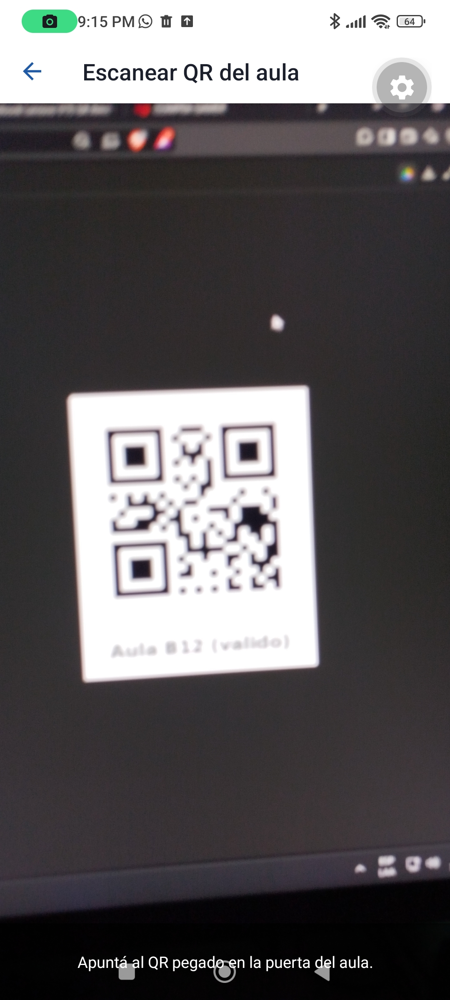 | La cámara apuntando al QR `IPF-AULA:B12`. |
| 2. Resultado | 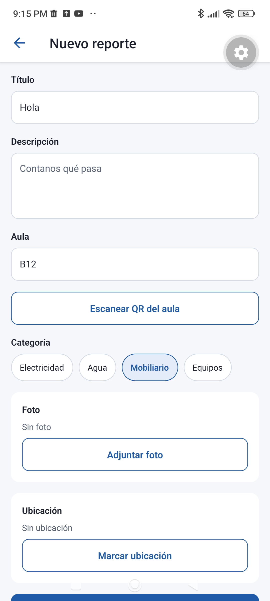 | Al leer el QR vuelve al formulario con **B12** en el campo Aula. |
| 3. Preguntable | — (ver nota) | Pantalla previa con un solo botón "Continuar" y el campo para escribir el aula a mano. |
| 4. Bloqueado | 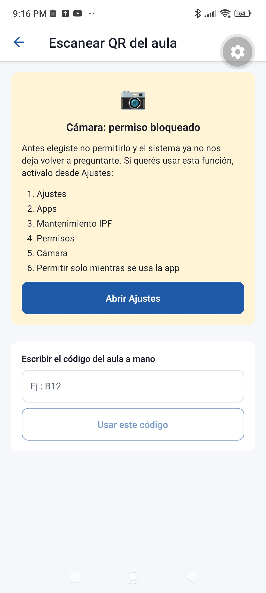 | Pasos exactos en Ajustes, botón "Abrir Ajustes" y, abajo, el campo para escribir el aula a mano. La app no se traba. |

> **Nota sobre el estado "cargando".** Dura unos milisegundos: el permiso ya está guardado en el sistema y la consulta es casi instantánea, así que no llega a dibujarse en pantalla. Es el `if (!permiso) return <Cargando />` de [src/app/reporte/escanear.tsx:33](src/app/reporte/escanear.tsx#L33).
>
> **Nota sobre el estado "preguntable".** En el celular de prueba, después de dos "No permitir", Android dejó la cámara marcada como *no volver a preguntar* (`user-fixed`). Ni elegir "Preguntar siempre" en Ajustes, ni reinstalar la development build, ni probar en Expo Go la devolvió a "sin decidir": **ese bloqueo lo decide el sistema, no la app**, que solo lee `canAskAgain`. El estado preguntable se dibuja en [src/app/reporte/escanear.tsx:52](src/app/reporte/escanear.tsx#L52) y usa el mismo componente `PantallaPrevia` que se ve en la captura de ubicación de más abajo, con el campo del aula a mano debajo.

### Pantalla previa y diálogo del sistema

| Captura | Qué se ve |
|---|---|
| 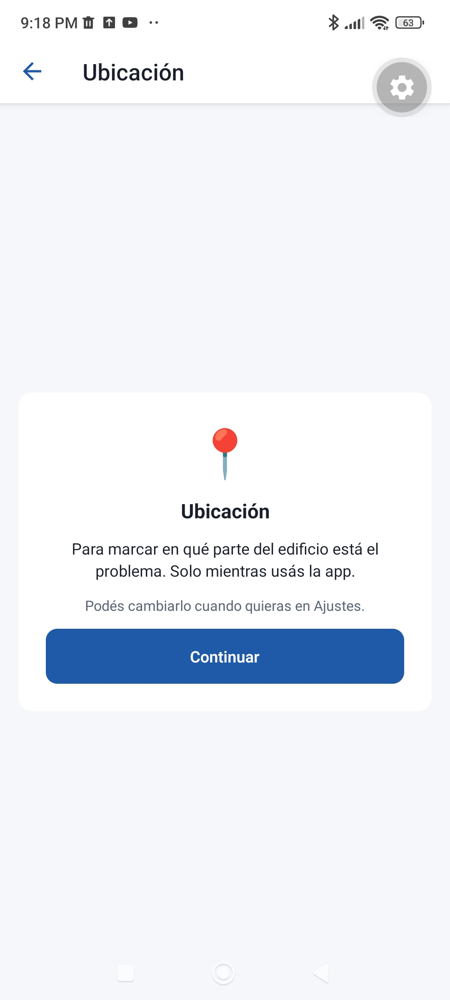 | **Pantalla previa** (`/permisos/[recurso]`): el beneficio en una frase, un único botón **"Continuar"** (sin "Ahora no" ni "Cerrar") y la aclaración de que se puede cambiar en Ajustes. |
| 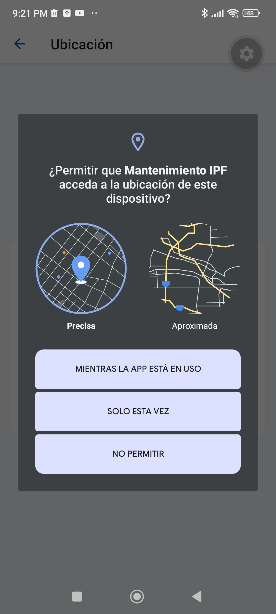 | **Diálogo del sistema** en la development build: dice *"¿Permitir que **Mantenimiento IPF**…?"*, con nuestro nombre y no el de Expo Go. Ofrece Precisa/Aproximada, "Mientras la app está en uso", "Solo esta vez" y "No permitir". |

> **Por qué no se ve el texto de propósito.** En Android el diálogo lo arma el sistema y **no admite texto propio**: el texto de propósito solo aparece en iOS, dentro del diálogo. Por eso, en Android la explicación va en nuestra pantalla previa (captura de la izquierda). Nuestros textos para iOS están en el `Info.plist` que genera Expo (`npx expo config --type introspect`, salida guardada en [docs/info-plist-ios.txt](docs/info-plist-ios.txt)):
> - `NSCameraUsageDescription`: "Usamos tu cámara para leer el QR de la puerta del aula y sacar fotos del desperfecto que reportás."
> - `NSLocationWhenInUseUsageDescription`: "Usamos tu ubicación para marcar en qué parte del edificio está el problema que reportás."

### Ubicación (`/reporte/ubicacion`)

| Captura | Qué se ve |
|---|---|
| 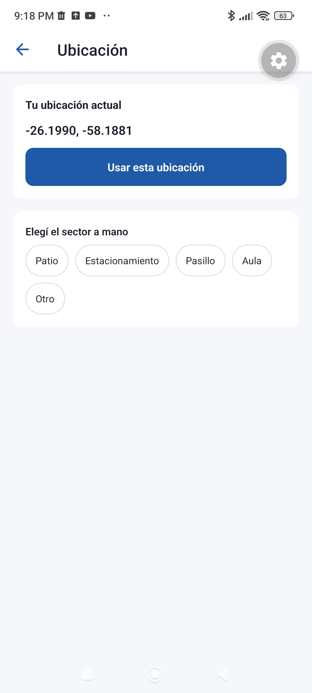 | **Concedida (precisa):** coordenadas con 4 decimales y "Usar esta ubicación". Los sectores siguen disponibles abajo. Si la ubicación fuera aproximada, mostraría "Ubicación aproximada" sin números. |
| 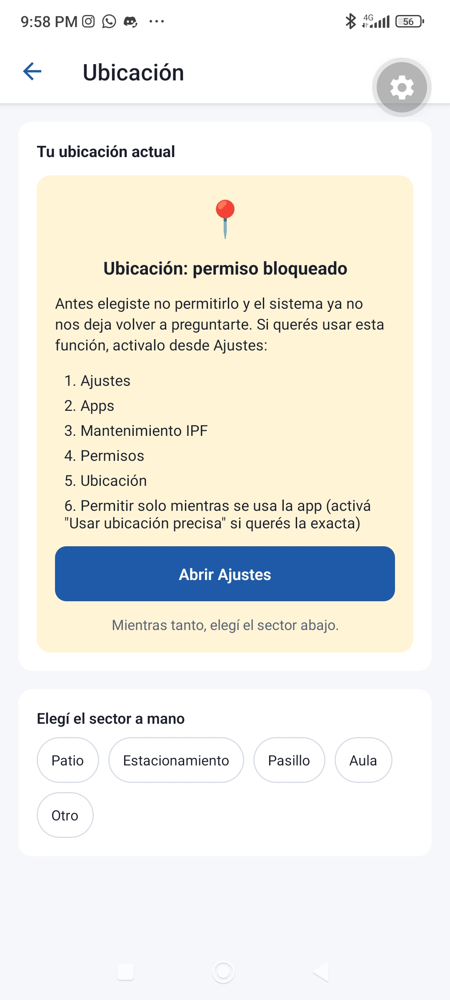 | **Denegada (bloqueada):** pasos en Ajustes, "Abrir Ajustes" y la lista de sectores para **elegir a mano**. El reporte se puede guardar igual. |
| 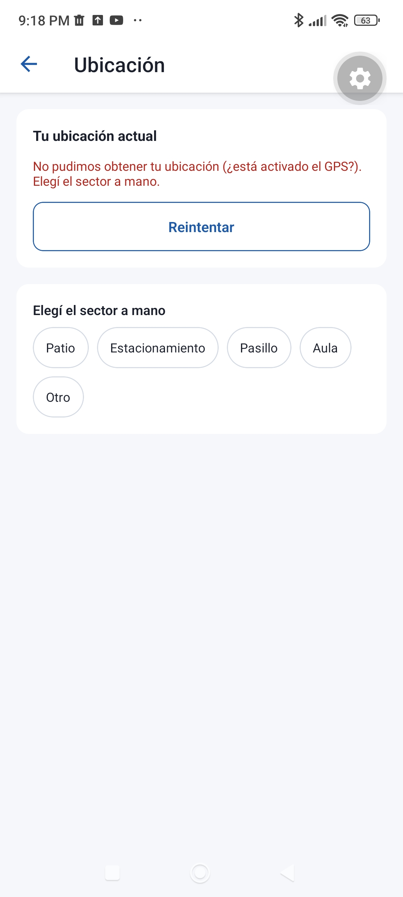 | **GPS apagado:** con el permiso concedido pero sin señal, muestra el error, "Reintentar" y los sectores. |

### Foto del desperfecto (`/reporte/foto`)

| Captura | Qué se ve |
|---|---|
| 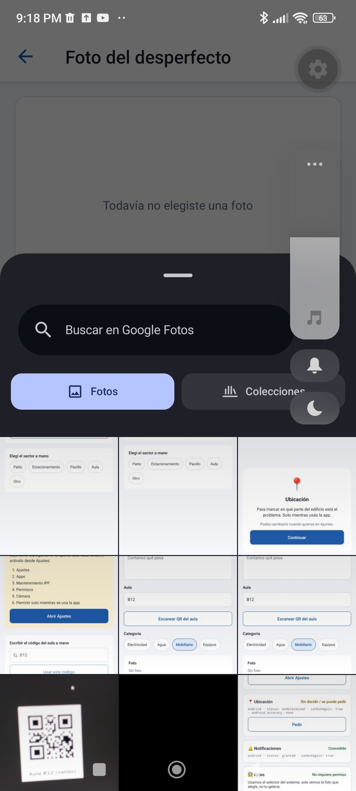 | **"Elegir de la galería"** abre el **selector del sistema** (Google Fotos) **sin ningún diálogo de permiso**: la app solo recibe la foto elegida, no la galería. (A la derecha se ve el panel de volumen del celular, que aparece al sacar la captura.) |
| 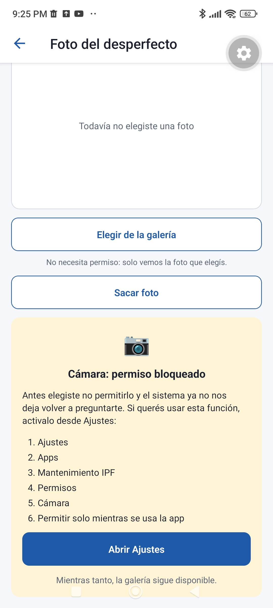 | **"Sacar foto" con la cámara bloqueada:** aviso con los pasos y "Abrir Ajustes", y la aclaración *"Mientras tanto, la galería sigue disponible"*. |

### Notificaciones

| Captura | Qué se ve |
|---|---|
| 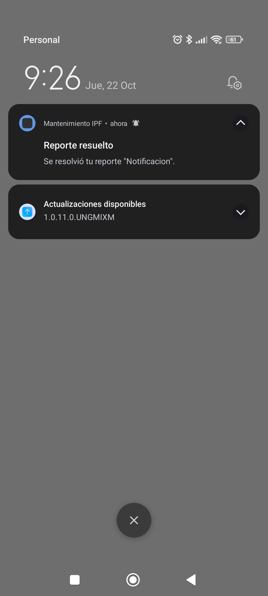 | **Notificación recibida** a los 10 segundos de tocar "Simular resolución": *"Reporte resuelto"*, en el canal `reportes`. Si el permiso está denegado, el mismo aviso aparece en la pestaña **Avisos**. |

### Panel de permisos (`/permisos`) y volver de Ajustes

| Captura | Qué se ve |
|---|---|
| 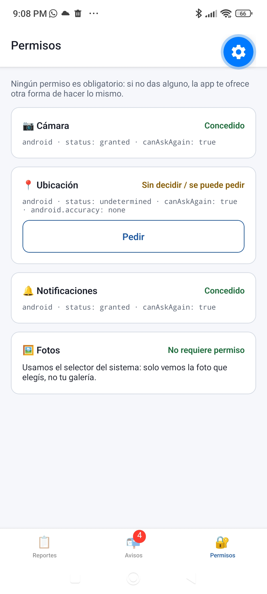 | **Antes:** cámara **Concedido** (`status: granted`, `canAskAgain: true`). Ubicación sin decidir, con el botón "Pedir". |
| 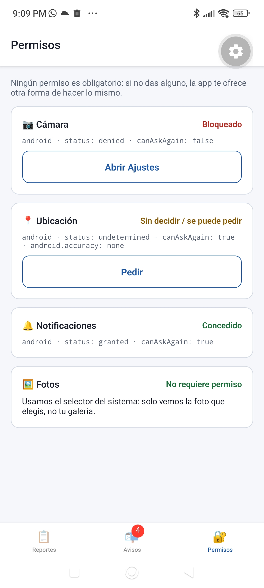 | **Después** de quitar la cámara desde Ajustes con la app abierta: Android reinició el proceso y, al volver, el panel muestra **Bloqueado** (`status: denied`, `canAskAgain: false`) con "Abrir Ajustes", sin tocar nada. |
| 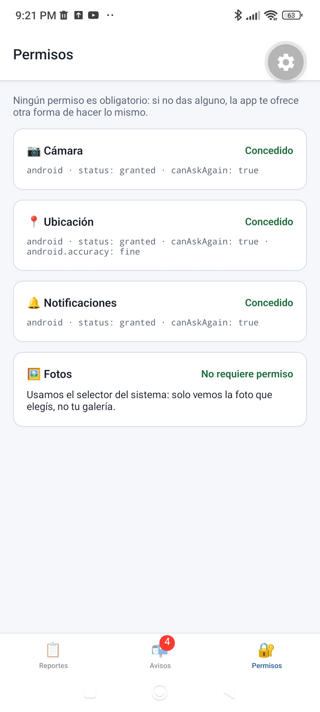 | Todos los permisos concedidos, con el matiz de la ubicación (`android.accuracy: fine`) y la fila fija de Fotos: "No requiere permiso". |

---

## Documentación

- [RESPUESTAS.md](RESPUESTAS.md): Partes A a F.
- [docs/PRUEBAS.md](docs/PRUEBAS.md): chequeos automáticos y pruebas manuales.
- [docs/DEFENSA.md](docs/DEFENSA.md): preguntas de la defensa oral con el archivo y la línea que las responde.
